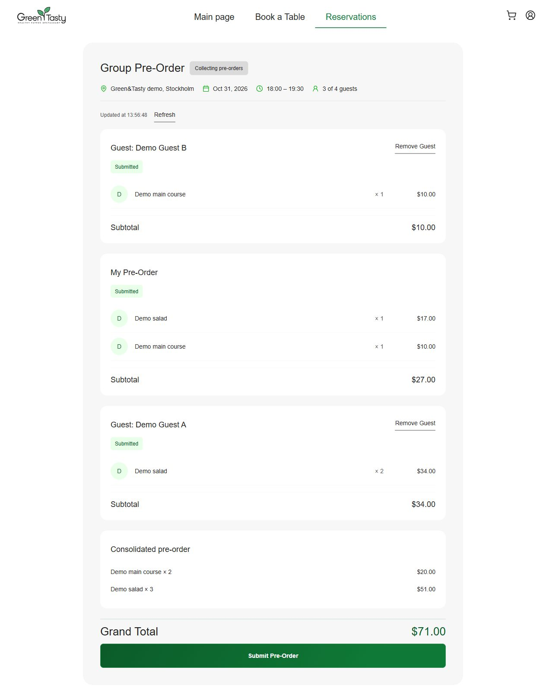
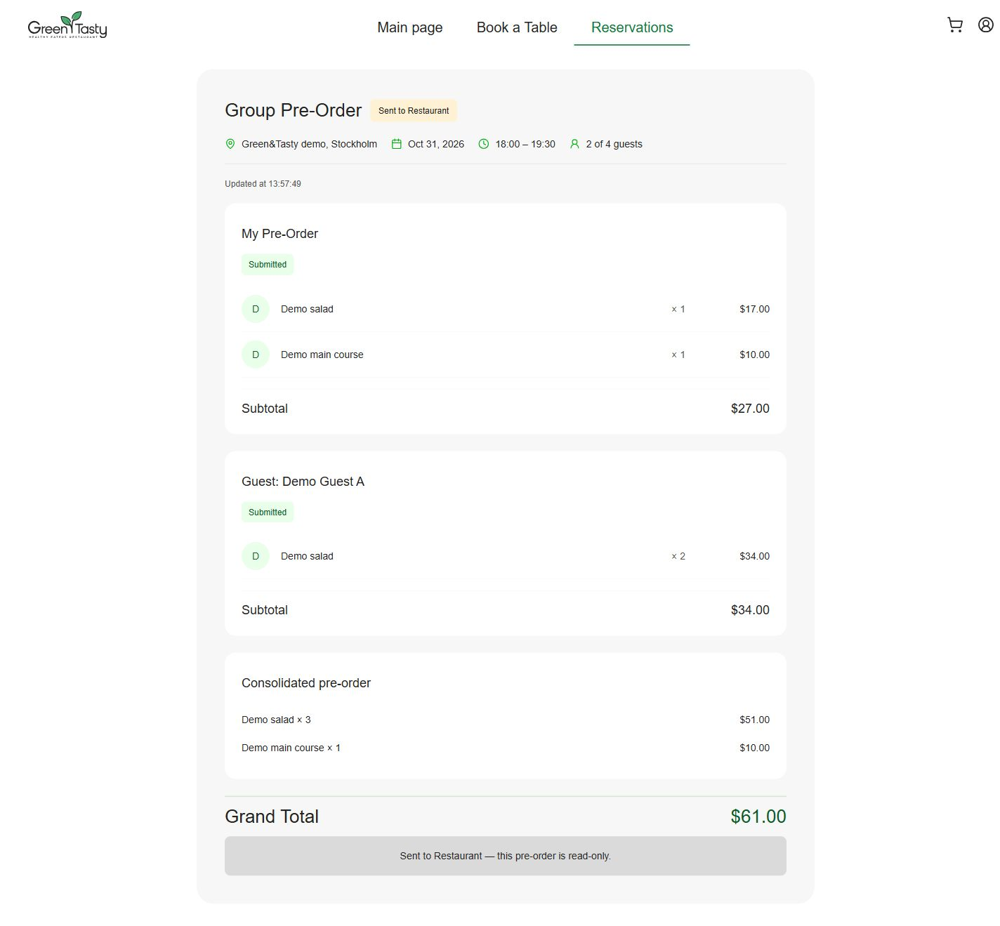
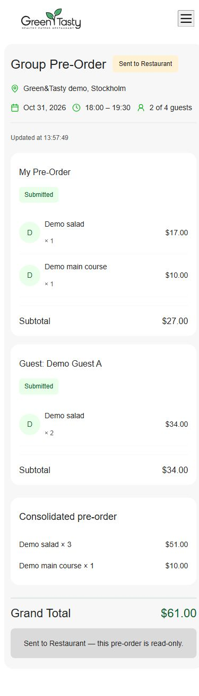

# Green&Tasty: production-виправлення та реальна E2E-перевірка

**30.10.2026. Основний сценарій завершено на справжньому AWS backend.** Owner і Guest A пройшли браузерні сценарії; окрема корзина Guest B створена та підтверджена через справжній API для перевірки незалежної сесії й polling. Owner Review, Remove Guest та фінальний Submit виконано у браузері. API-перевірки нижче відокремлено від UI-перевірок.

Frontend: **https://greentasty-epam-impoil.pages.dev**. Backend: **https://7srgpvk8of.execute-api.eu-north-1.amazonaws.com/demo**. Account **071954286972**, `fresh-deploy`, **eu-north-1**. Використано ті самі 3 Cognito identities, 5 seed items і бронювання на **31.10.2026 18:00–19:30 Europe/Kyiv / 16:00–17:30 UTC**. Нових users/seed/reservations не створювали.

## Мінімальне frontend-виправлення

Production commit: **`a6d76c2871b4c5fc47d931911bf83e099e005af8`**, `1.2.1 Fix confirmed reservation pre-order navigation`, без `[CF-Pages-Skip]`.

`ReservationInviteModalComponent.onMakePreOrder()` тепер передає `preOrder: 'true'`, актуальний `reservationId` і `reservationLabel`. Невеликий спільний `buildPreOrderQueryParams` використовують confirmation modal і `CardReservationComponent.onPreOrder()`. Формат label/card navigation збережено: location, named table або tableId fallback, локальні дата й час. Параметри обчислюються до `closed.emit()`, щоб закриття modal не втратило input.

Змінено лише два компоненти, їхній маршрутний helper і регресійні тести. Backend/business logic, залежності та AWS Terraform не змінювалися.

| Перевірка | Результат |
| --- | --- |
| TypeScript app / spec | Passed / Passed |
| Цільові modal/helper regression tests | **15 passed, 0 failed** |
| Homework tests | **82 passed, 0 failed** |
| Повний frontend suite | **287 passed / 47 failed**; baseline **283 / 47**, усі 47 імен failures збігаються, **0 нових failures** |
| Локальна production build | **1**, справжній BACKEND_URL; bundle check passed, initial **971.86 kB** |
| Pages artifact check | Passed: 98 files, найбільший 11 620 373 bytes, SPA/security headers |

Не створювали друге бронювання заради повторного confirmation modal: його перехід перевірено регресійним компонентним тестом. Production E2E відкривав pre-order на наявному reservation через Reservations card, яка використовує той самий helper.

## Публікація перевірена

Cloudflare Pages для commit **`a6d76c2`**: **completed / success**, `Deployed successfully`. У справжньому браузері production завантажив **`main-WSZ525R4.js`**, що збігається з локальною production build; попередній asset — `main-QBC55UA6.js`.

Push виправлення ініціював одну Cloudflare publication. Повторних build/retry deployment не запускали. Подальший документаційний commit використовує `[CF-Pages-Skip]`.

## Реальні дії та суми

Перед кожною business mutation перевіряли поточний snapshot/status або порожню корзину. Записи виконувалися тільки через справжні application endpoints; прямі DynamoDB writes не використовувалися.

| Крок | Метод перевірки | Результат |
| --- | --- | --- |
| Повторний звичайний Owner login | Production browser, DPAPI credentials | Успішно, без demo-login |
| Owner personal pre-order | Browser: $17 + $10, один order, один submit | **$27**, Owner `isSubmitted=true`; group ще Open |
| Відкриття invitation і join Guest A | Анонімний browser, без Cognito login | Одна Guest A session |
| Guest A cart і submit | Browser: 2 × $17 | **$34**, submitted |
| Owner Review | Browser | Owner $27 + A $34 = **$61** |
| Незалежна Guest B cart | Справжній API, окремий guest bearer | $10, один submit; browser-створення B **не перевірялося** |
| Polling Owner Review | Browser без ручного refresh після API writes | Guest B з’явився, **3 participants, $71** |
| Ручний Refresh | Browser | Той самий snapshot **$71** |
| Remove Guest B | Browser, confirmation dialog | Видалена тільки створена тестова B session, **$71 → $61** |
| Final Submit | Browser, confirmation dialog, **один успішний submit** | Group Submitted; замовлення **$61** |
| Final read-only | Browser, також нова вкладка з тією самою URL | `Sent to Restaurant`, **0 Submit / 0 Remove controls** |

Viewport: desktop **1440×900**, mobile **390×844**; full-page screenshots можуть бути вищими за viewport. Тимчасовий override скинуто. Passwords, JWT, guest bearers та invite values у screenshots відсутні.

## Негативні перевірки API

Ці перевірки доповнюють браузерний сценарій, а не замінюють його. Guest B використовував власний bearer, Customer B — окремий справжній Cognito ID token. Snapshot до/після відмов порівняно; він не змінився.

| Перевірка | Фактичний результат |
| --- | --- |
| `/me` без авторизації | **401** |
| Customer B: чуже reservation / existing order / Owner Review | **403 / 403 / 403** |
| Customer B: final submit чужої групи | **403**, group лишилася Open |
| Guest B bearer: читання Guest A session | **401** |
| Guest bearer: Owner Review | **401** |
| Повторний guest submit після перевірки `isSubmitted=true` | **409** |
| Видалена Guest B session зі старим bearer | **401** |
| Повторний final submit після перевірки Group Submitted | **400**, `errorCode=GroupReservationSubmitted` |
| Owner edit order після final Submit | **400**, group no longer editable |
| Customer B: фінальний чужий order | **403** |

Повторні submit тут — **навмисні негативні тести**, після перевірки вже submitted стану; вони не створили повторних успішних записів. Усі **68** збережених API-запитів мають очікувані статуси (включно з читаннями/перевірками перед записом), точний production CORS origin. [Обезособлені requests](e2e-completed-evidence/requests.json), [підсумок](e2e-completed-evidence/summary.json).

## Фактичні стани .NET і DynamoDB

Фінальні значення підтверджені API і **consistent-read DynamoDB GetItem** з projection лише status/dishes, без secret fields:

- Group — **Submitted**, stored `status.N=1`.
- Order — **SubmittedByCustomer**, stored `status.N=3`; це ще не підтвердження офіціантом.
- Склад order: **3 × Demo salad ($17) + 1 × Demo main course ($10) = $61**.
- Owner participant — $27, submitted; Guest A — $34, submitted; Guest B відсутній.
- Reservations **1**, GroupReservations **1**, Orders **1**, GuestSessions **2**, Notifications **1**. Locations/Tables/Waiters **1/1/1**, Dishes **2**. Cognito identities залишилися **3**.

Початкові та фінальні дані не дублювалися. Group вже submitted і не призначена для повторення mutation-сценарію. Для наступного повного проходу потрібне окремо узгоджене нове бронювання; не скидати status, не редагувати DynamoDB вручну й не повторювати seed.

## Безпека, інфраструктура та межі перевірки

CloudWatch прочитано з пагінацією: **561 events, 136 REPORT**, **0 exceptions/timeouts/AccessDenied**. ERROR messages відповідають очікуваним негативним тестам/початковому відсутньому order. Polling був звичайною роботою UI з інтервалом 15 секунд; load testing не проводився. API-діагностика виконувалася послідовно з паузами для дотримання demo throttling.

Free Plan після перевірки: **FREE / ACTIVE**, API показує **$140** credits, expiration **26.04.2027 17:11:35 UTC**. Це не остаточний invoice. Billing/quotas не змінювалися.

Усі **10 захищених snapshots** до/після збіглися: 7 HW4/HelloWorld snapshots, hw6 state metadata, hw6 Lambda CodeSha256/RevisionId/LastModified та Lambda account settings. Terraform commands/apply/destroy, state writes/migration, Lambda/Cognito configuration changes, cleanup та merge не виконувалися. Видалення обмежене штатним Remove Guest для нової тестової B session.

Credentials використано з попереднього локального Windows DPAPI-файлу. Secrets не включені до Git/JSON evidence/screenshots; артефакти перевірено на збіги з фактичними passwords/ID tokens/guest bearer/invite. Тимчасові plaintext файли прибираються після завершення. У цьому проході browser snapshots перед виведенням редагувалися, діючі invite URLs не виводилися.

**Залишкові обмеження:**

- 47 старих frontend test failures не виправлялися, нових failures немає.
- У Reservations спостерігався неблокуючий toast від feedback endpoint, відсутнього в мінімальному deployment. Personal pre-order та основний сценарій після цього виконані успішно. Feedback/інші модулі поза ДЗ №5–6 не розширювалися.
- Guest B actions перевірені API, **не окремим браузерним профілем**. Усі ключові Owner/Guest A/Review/Remove/Submit UI transitions перевірені справжнім браузером.
- Нова confirmation flow після створення другого reservation навмисно не відтворювалася: її routing regression покрито тестами, а production версію підтверджено asset hash і Cloudflare check.

PR #2 залишається **Draft**. Історичний перерваний прохід до виправлення: [попередній звіт](real-e2e.md).
