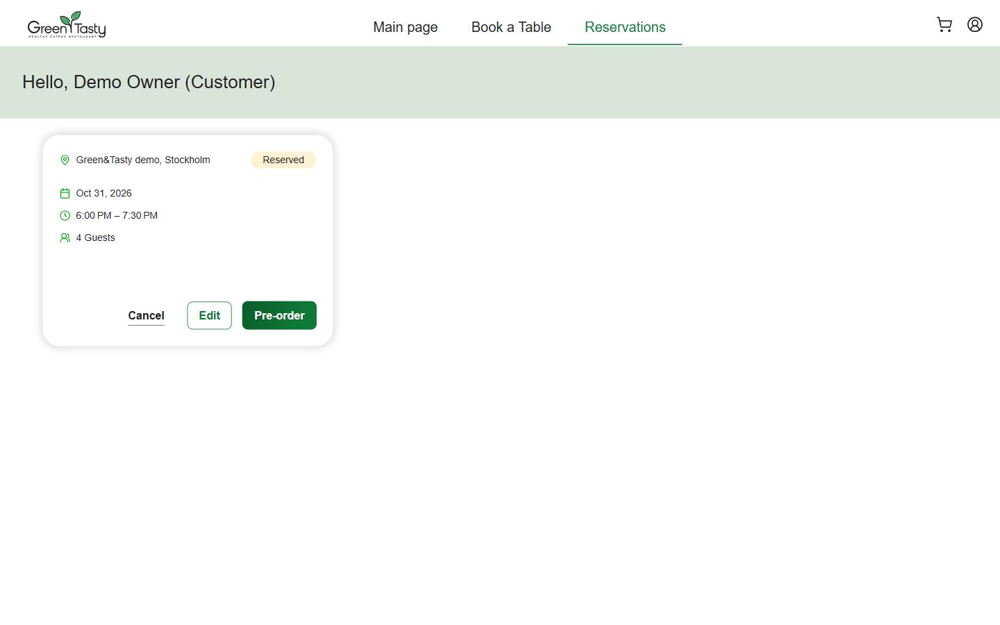
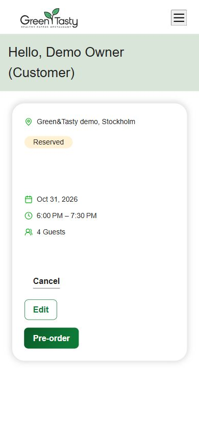
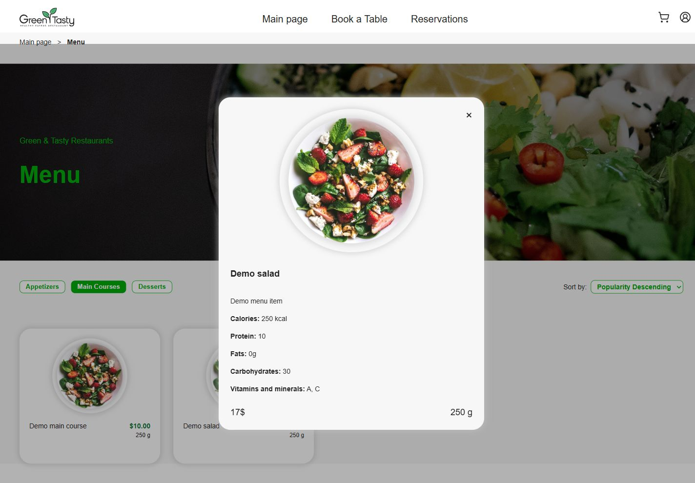
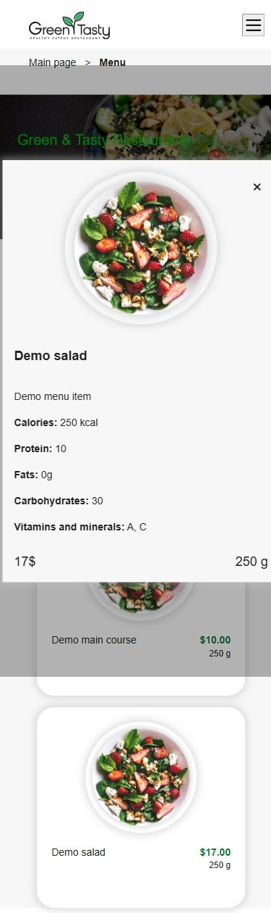

# Реальна E2E-перевірка Green&Tasty — 30.10.2026

**Результат: частково виконано, подальші записи зупинено через дефект UI.** Це перевірка опублікованого Angular і справжнього AWS .NET API, не demo-login і не моки. Повний сценарій ДЗ №5–6 поки **не підтверджено**.

Frontend: https://greentasty-epam-impoil.pages.dev. Backend: https://7srgpvk8of.execute-api.eu-north-1.amazonaws.com/demo. Account **071954286972**, профіль `fresh-deploy`, регіон **eu-north-1**. Вихідний commit гілки/PR #2: `4cd54b1376c9c1e2319b1cc26b434c1cd142d663`; робоча копія перед початком була чистою.

## Підготовлені демонстраційні дані

Створено **3 синтетичні Cognito identities**, усі `CONFIRMED` і Enabled:

| Позначення | Призначення |
| --- | --- |
| Customer A | Власник бронювання, Owner за `reservation.customerId == Cognito sub` |
| Customer B | Перевірка заборони доступу до чужого бронювання та Owner Review |
| Waiter identity | Справжній sub використано у записі DynamoDB Waiters для автоматичного призначення офіціанта |

Customer A/B додано до **наявної** групи Customer. Нових груп Owner/Waiter не створювали. Waiter identity потрібна для призначення бронювання; окремий рольовий UI офіціанта не перевірявся. Використано наявні User Pool/App Client. `MessageAction=SUPPRESS`, без телефонних атрибутів: email/SMS не надсилалися. Задано випадкові 16-символьні постійні паролі з upper/lower/digit/symbol; вони відповідають Cognito policy і звичайному `/signin`, без NEW_PASSWORD_REQUIRED.

Credentials зберігаються **тільки локально**, зашифровані Windows DPAPI для поточного користувача/комп’ютера. Файл не входить до repository, звіту або screenshots. Передача екзаменаторам паролів/токенів через Git не передбачається; власник комп’ютера отримує доступ окремим локальним скриптом.

Перевірено наявний `infra/hw6-greentasty/scripts/seed.ps1`: він підтримує dry run та `attribute_not_exists` для кожного put. Додатково перед його виконанням **усі п’ять ключів** перевірено consistent-read. До створення users також перевірено відсутність статичних seed keys та записів Waiters. Збігів/часткових даних не було; перезаписів немає. Створено й перевірено:

- 1 локацію `Green&Tasty demo, Stockholm`;
- 1 стіл №1, місткість **6**;
- 1 запис Waiters з реальним Cognito sub третьої identity;
- `Demo salad` — **$17** і `Demo main course` — **$10**.

Reservation, GroupReservation та початкова Owner session створені **через production frontend / справжній API**. Прямих записів у Reservations, GroupReservations, GuestSessions або Orders не виконували. Групове бронювання для **4 людей** на **31.10.2026, 18:00–19:30 Europe/Kyiv**; API повернув **16:00–17:30 UTC**. Стіл має місткість 6; production UI обмежує звичайну форму чотирма учасниками.

## Що перевірено реальним браузером

Використано справжній in-app Chromium browser із production origin. Screenshots: desktop **1440×900**, mobile **390×844**, без активних invite/password/token fields.

| Сценарій | Фактичний результат |
| --- | --- |
| Звичайний вхід Customer A | Успішний; UI показує Demo Owner (Customer) |
| Меню та локація | Видно справжні seed dishes $17/$10 і локацію з API |
| Пошук столу | 1 доступний стіл №1, до 6 гостей |
| Confirm reservation | Один успішний запис, UI `Reservation Confirmed`; у Reservations — `Reserved`, 4 Guests |
| Перехід Make Pre-Order з confirmation | **Дефект:** відкриває звичайне меню без контексту бронювання |
| Особистий pre-order, guest carts, Owner Review UI, Remove Guest, final Submit | **Не виконано після зупинки** |

## Блокер і запропоноване мінімальне виправлення

`ReservationInviteModalComponent.onMakePreOrder()` у `frontend/restaurant-frontend-app/src/app/components/reservations/reservation-invite-modal/reservation-invite-modal.component.ts` переходить лише на `['/menu']`. Після натискання Make Pre-Order браузер показує menu і read-only dish modal без кнопки додавання до pre-order.

У наявному `CardReservationComponent.onPreOrder()` вже використовується коректний перехід на `/menu` з `preOrder: 'true'`, `reservationId` і `reservationLabel`. Мінімальна пропозиція: передати цей самий контекст із confirmation modal, бажано використавши спільну логіку формування параметрів. Додати цільову перевірку переходу та повторити браузерний сценарій на **наявному**, а не новому бронюванні.

**Frontend/backend source не змінювалися.** На вимогу користувача після виявлення дефекту припинено нові business writes; обхід через інший UI entry point та API не використовувався для оголошення E2E успішним. Подальші перевірки були лише read-only.

## Окремі API-перевірки

Ці перевірки **не замінюють** неперевірені UI-сценарії. Обезособлені результати: [requests.json](e2e-evidence/requests.json), [summary.json](e2e-evidence/summary.json). Запити виконано без навантажувального тестування; credentials/JWT/invite values вилучені.

| Перевірка | Статус |
| --- | --- |
| POST `/signin`, Customer A і B | **200**, звичайні ID/access tokens отримані лише локально |
| GET `/me`, A і B | **200**, роль Customer |
| GET `/me` без авторизації | **401** |
| GET власного reservation, Customer A | **200** |
| GET чужого reservation, Customer B | **403** |
| GET Owner Review без авторизації | **401** |
| GET чужого Owner Review, Customer B | **403** |
| GET Owner Review, Customer A | **200**, лише Owner participant, сума **$0** |
| GET public invite за локальним token | **200**, група/бронювання доступні для перегляду |
| GET group status | **200**, `Open`, currentParticipants **1**, maxCapacity **4** |
| GET чужого Orders/{reservation}, коли order ще відсутній | **404 Order not found**; перевірка IDOR існуючого order **не зараховується** |

У журналі **14 очікуваних успішних API-перевірок** і **1 непридатна перевірка**. Для останньої первісне очікування 403 було некоректним: order ще не існує. Запит не повторювали та не створювали order заради перевірки після зупинки. Усі отримані відповіді мають точний Access-Control-Allow-Origin production Pages.

Не перевірено: створення окремих guest carts, ізоляцію між guest bearer sessions, guest submit/re-submit, Remove Guest і недоступність видаленої session, перерахунок Grand Total, final Submit, повторний final Submit та фінальний read-only стан. Ці результати не виводяться з unit tests або огляду коду.

## Фактичний стан після зупинки

| DynamoDB table | Кількість записів |
| --- | ---: |
| Locations / Tables / Waiters | **1 / 1 / 1** |
| Dishes | **2** |
| Reservations / GroupReservations | **1 / 1** |
| GuestSessions | **1**, автоматична Owner session; зовнішніх гостей **0** |
| Orders / Notifications / Feedback | **0 / 0 / 0** |

Reservation — `Reserved`; group — **Open**; Owner items — порожні, `isSubmitted=false`; поточна сума **$0**. Це **не** завершений чи submitted order. Жодних підсумкових сум після Remove Guest не отримано. Дані залишені для продовження; повторний seed/user creation заборонений без перевірки наявного стану.

CloudWatch після початку перевірки: **24 REPORT**, **0 exceptions/timeouts/AccessDenied**. Є три очікувані ERROR messages від негативних read-only перевірок: доступ до чужого reservation, відсутній order, доступ до чужого Owner Review. Raw logs не публікуються.

AWS Free Plan після перевірки — **FREE / ACTIVE**, API показує **$140** credits, expiration **26.04.2027 17:11:35 UTC**. Це не фінальна сума invoice. Billing/quotas не змінювалися.

## Секрети та збереження інфраструктури

- Паролі та діючі tokens/invite values відсутні у Git, звіті, JSON evidence і screenshots. Одне початкове AX-спостереження confirmation dialog автоматично показало invite URL у службовому виводі браузера; його не повторювали та не переносили до збережених матеріалів. Подальші текстові знімки редагувалися перед виведенням. Запрошення не змінювали після зупинки business writes.
- Наявні AWS resources, Terraform configuration/state, HW4 та HelloWorld не змінювалися. Metadata/VersionId/ETag hw6 state до/після збігаються; збіглися всі 7 захищених HW4/HelloWorld snapshots і Lambda account settings.
- Terraform commands, apply/destroy, state migration, quota/billing changes, нові access keys та cleanup не виконувалися. Прямі data writes обмежені трьома синтетичними identities/Customer memberships та п’ятьма seed items. Подальші application writes — тільки створене через frontend бронювання і автоматичні похідні дані.
- PR #2 залишається **Draft**, merge не виконувався. Документаційний commit використовує **`[CF-Pages-Skip]`**.

Наступний крок потребує дозволу на мінімальне frontend-виправлення та його публікацію. Після цього продовжити на існуючих users/seed/reservation: Owner personal cart → guest joins/carts → Owner Review refresh → Remove Guest → total recalculation → final Submit/read-only та negative authorization checks.
